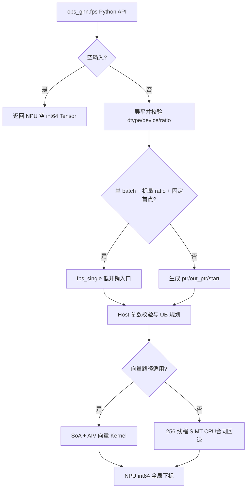

# 需求背景（required）

## 需求来源

本需求来自 CANN 2026 年 8 月社区任务“fps 算子开发（950）”。任务要求参考 `torch_cluster.fps`，在 Ascend 950 系列 NPU 上实现 Ascend C Kernel 与 PyTorch 适配层，并以 PyTorch 层 `ops_gnn.fps()` 的功能、精度和性能作为验收口径。

## 背景介绍

### FPS 算子实现优化

FPS（Farthest Point Sampling，最远点采样）广泛用于点云下采样、3D 检测 backbone 和几何深度学习。算法从每个 batch 的一个起点开始，反复选择距已选点集最远的点。它能在减少点数的同时尽量保留点集的空间覆盖范围。

FPS 的每轮采样依赖上一轮选出的中心点，属于强迭代依赖算法；但一轮内部对所有候选点的距离更新和最大值选择可以并行。实现需要在迭代依赖、向量吞吐、UB 容量和离散下标精确一致之间取得平衡。

### torch_cluster FPS 实现路径和相关 API 路径

- Python 接口：`torch_cluster/fps.py`
- CPU 参考：`csrc/cpu/fps_cpu.cpp`
- CUDA 参考：`csrc/cuda/fps_cuda.cu`
- 本实现 Python 接口：`python/ops_gnn/fps.py`
- 本实现 Host：`csrc/npu/fps/op_host/`
- 本实现 Kernel：`csrc/npu/fps/op_kernel/arch35/`

### 原版能力与本次实现范围

| 参数 | 参数含义 | 类型 | 支持范围 | 约束 |
| --- | --- | --- | --- | --- |
| `src` | 点特征 | Tensor | float16、float32 | NPU；`[N, *]`，内部展平为 `[N, F]` |
| `batch` | batch 归属 | 可选 Tensor | int64 | `[N]`，同一 batch 的点连续排列 |
| `ratio` | 采样比例 | 可选 float/Tensor | float16、float32 | 标量或 `[B]`，每项位于 `(0, 1]` |
| `random_start` | 是否随机首点 | bool | `True`/`False` | `False` 时使用段内下标 0 |
| `batch_size` | batch 数 | 可选 int | 正整数 | 未给定时为 `max(batch)+1` |
| `ptr` | CSR 分段边界 | 可选 Tensor/List | int64 | 单调非降，首项 0，末项 N |
| 返回值 | 全局采样下标 | Tensor | int64 | NPU，长度为各段采样数之和 |

# 需求分析（required）

## 需求描述

在 `ops-gnn` 中新增与 `torch_cluster.fps` 同签名的 Python API、四个 TorchScript overload、Ascend 950 arch35 Host/Kernel 实现、CPU golden、自测用例、性能测试和文档。功能输出必须与真实 torch_cluster 1.6.3 CPU 数值和首索引 argmax 语义一致；42 个官方性能点均需达到标杆性能的 0.45 倍。

## 需求拆解

1. 对齐公开 Python 签名以及 `ratio`、`batch`、`ptr`、空输入和随机起点语义。
2. 支持 float16/float32 输入和 int64 元数据/输出。
3. 每个 batch 按 torch_cluster 1.6.3 CPU 路径输出 `ceil(float32(degree_b) * ratio_b)` 个全局下标；Python 标量 ratio 先转为 `src.dtype` Tensor，Tensor ratio 保留输入 dtype。
4. 保持真实 CPU `(x-x[idx]).pow_(2).sum(1)` 数值边界和 `argmax` 最低绝对 index 平局规则。
5. 为官方 N/F/r 性能矩阵提供低开销向量路径，同时覆盖大 N、大 F 泛化形状。
6. 提供可独立复现的自建61场景当前合同测试、完整仓回归、旧附件/raw upstream兼容对拍和42项性能门禁；不冒充未取得源码的验收方66项套件。

# 详细设计（required）

## 算子分析

### 数学公式

设某一 batch 的点为 $X=\{x_i\}_{i=0}^{N_b-1}$，已选下标集合为 $S_t$。对每个候选点维护到已选集合的最小平方欧氏距离：

$$
d_i^{(t)}=\min_{j\in S_t}\lVert x_i-x_j\rVert_2^2.
$$

第 $t+1$ 个采样点为：

$$
s_{t+1}=\operatorname*{argmax}_{i} d_i^{(t)}.
$$

每个 batch 的输出数：

$$
K_b=\left\lceil r_b N_b\right\rceil,
\qquad
K=\sum_b K_b.
$$

### 支持数据类型

- `src`：float16、float32。
- `batch`、`ptr`、`out_ptr`、`start`、输出：int64。
- Host 内部归约暂存：float32 距离与 int64 下标各256项，供SIMT回退路径跨lane合并。

### 支持形状

- Python 层接受 `[N, *]`，以 `reshape(N, -1).contiguous()` 展平。
- `N=0` 时返回空输出。
- 任务功能用例覆盖 `N=1..32000`、`F=3..768`。
- 任务性能矩阵覆盖 `N=1024..16384`、`F=4/16/32/64`、`ratio=0.25/0.5/1.0`。

## 算子实现

### 实现方案

##### 整体执行流程

##### Host 侧设计

**Python 适配层**

1. 提供任务书要求的四个 `@torch.jit._overload`；TorchScript 分支经 `torch.ops.ops_gnn.fps_batch` Dispatcher 入口调用同一 Host/Kernel，并保留 eager 模式的低开销 pybind 快路径。
2. `ratio=None` 转为 `0.5`；标量或 Tensor 均检查 `(0, 1]`。
3. `ptr` 优先；否则由 `batch` 计数并生成 CSR `ptr`；两者均无时生成 `[0, N]`。
4. 将 degree 转为 float32，再与 ratio Tensor 相乘并 ceil 生成 `out_ptr`；单 batch 快路径也执行相同的 ratio dtype 和 float32 乘法规则。
5. `random_start=True` 使用与 torch_cluster 1.6.3 CPU 相同的进程全局 `libc rand() % degree`；该状态不受 `torch.manual_seed` 控制。否则首点为 0。
6. 官方性能场景满足“单 batch、标量 ratio、固定首点”，直接调用 `fps_single`，避免构造/回读小型元数据 Tensor。

**C++ Host 层**

1. 校验 `src` 为二维连续 NPU Tensor，dtype 为 float16/float32。
2. 批量入口校验 `ptr/out_ptr/start` 的 device、dtype、维度、连续性、首尾值、单调性和范围。
3. 从当前 PyTorch NPU stream 下发 Kernel，不做额外 stream 同步。
4. 查询平台 UB 大小，预留中心点、三个点向量和归约 workspace，按 256 点对齐计算 `tile_points`，最大为 16384。
5. 分配 `dist[N]`、输出 `out[K]`；SIMT回退路径额外使用256项 `best_dist/best_index`。

##### Kernel 侧设计

内核包含两条执行路径。

**AIV 向量性能路径**

- 适用条件：`N <= 16384`，且 float32 时 `F <= 64`；float16 在该 N 范围均可进入。
- Host 将输入从 AoS `[N,F]` 转置为 SoA `[F,N]`，使同一 feature 的点连续，便于向量搬运。
- fp16先按half执行减法与平方，每维square转fp32累加，全部feature完成后舍回fp16距离；nearest状态保持fp16。
- 当前验证环境的PyTorch 2.9.1 CPU capability报告AVX512，但连续fp32 sum实测使用W=8、ILP=4加法树。F=5..64按该四行partial、scalar tail和lane0..7水平顺序合并；F<=4保留等价低开销路径。
- `nearest = min(nearest, current_distance)` 始终驻留 UB；每轮用 `ReduceMax` 取得下一中心点。
- tile点数按256对齐仅服务搬运和归约布局，不改变公开平局语义。
- 若最大距离存在平局，tile内及跨tile均选择最低绝对index，匹配CPU `argmax` 首索引。

**SIMT CPU合同回退路径**

- float32：`F > 64` 或 `N > 16384`。
- float16：`N > 16384`。
- 256个SIMT线程各处理 `lane + 256*k` 的点；线程内严格大于时更新，相等时保留较小绝对index，lane间再按 `(distance desc, absolute index asc)` 合并。
- fp16减法与平方分别舍回half，square转fp32后顺序累加，最终距离舍回half。
- fp32执行与当前PyTorch build实测一致的W=8/ILP=4完整四级cascade并分离乘法和加法，避免FMA收缩。该加法树绑定当前验收环境，不宣称跨PyTorch/ISA普遍bitwise。
- nearest初值使用正无穷，避免固定50000截断合法大距离。

**batch 调度**

不同 batch 的输出区间可能共享一个 32 字节 GM transaction。为避免非对齐 int64 标量写之间的竞争，当前由一个 AIV block 顺序处理各 batch。官方性能矩阵均为单 batch，不受该策略影响。

## 数据检测

- `src`：定义、NPU、连续、float16/float32、点数不超过 int32 上限。
- `batch`：一维、长度 N、int64；batch 点按 CSR 顺序连续排列。
- `ratio`：标量或每 batch 一项，非空且所有值位于 `(0, 1]`。
- `ptr`：一维 int64，至少两项，单调非降，首项 0、末项 N。
- `out_ptr`：长度与 `ptr` 相同、首项 0、单调非降，每段输出数不超过该段点数。
- `start`：长度为 batch 数；非空段中满足 `0 <= start < degree`。

## 支持硬件

| 支持的芯片版本 | 涉及勾选 |
| --- | :---: |
| Ascend 950PR / Ascend 950DT（dav-3510 / arch35） | √ |
| Atlas A2/A3（dav-2201 / arch22） | × |

## 算子约束限制

- 当前仅实现 NPU 路径，不提供 CPU fallback。
- `batch` 描述的同一 batch 点需要连续排列，这与 CSR `ptr` 语义一致。
- 输入 dtype 仅支持 float16、float32；索引和输出仅支持 int64。
- `ratio` 不支持 0、负数或大于 1 的值。
- FPS 存在逐轮依赖，采样比例越高，迭代次数和耗时近似线性增加。

# 可维可测分析

## 精度标准/性能标准

| 验收标准 | 描述 | 标准来源 |
| --- | --- | --- |
| 精度标准 | 固定起点时，float16/float32 的 int64 输出下标与任务 CPU golden 逐元素完全一致 | FPS 社区任务书 |
| 随机性标准 | CPU/NPU调用前分别固定同一libc srand，CPU单线程时 `random_start=True` 下标一致 | torch_cluster 1.6.3 CPU + 正式CPU验收口径 |
| 性能标准 | 21 个形状 × 2 个 dtype 共 42 项，每项 `official_reference_ms / measured_ms >= 0.45` | FPS 社区任务书 |

## 测试用例规划

| 分类 | 用例 | 输入/参数 | 判定 |
| --- | --- | --- | --- |
| 基本功能 | 常规形状 | N=128/256/512/1024/2048，F=3/32/64 | 下标逐元素一致 |
| 泛化形状 | 大 N/大 F | `(4096,128)`、`(8192,256)`、`(512,768)`、`(32000,3)`、`(16000,128)` | 下标逐元素一致 |
| dtype | fp16/fp32 | 所有主要形状 | 下标逐元素一致 |
| batch | 单/多/每点一 batch | 4×64、5×1 | shape、dtype、全局下标一致 |
| CSR | List/Tensor、非均匀段 | `[0,32,96,128]`、`[0,40,100,120]` 等 | 下标逐元素一致 |
| ratio | 标量/逐 batch/边界 | 0.01、0.25、0.5、0.9、1.0 | ceil 长度和下标一致 |
| 起点 | 固定/随机 | `random_start=False/True` | 精确一致/固定libc srand可复现 |
| 空输入 | `[0,3]` | ratio=0.5 | NPU 空 int64 输出 |
| 平局 | 多个绝对下标等距 | fp16/fp32 | 与CPU argmax一致，选择最低绝对index |
| TorchScript | float/Tensor ratio × Tensor/List ptr | 四种 overload | 编译通过且 NPU 结果与 eager 一致 |
| 性能 | 官方矩阵 | 21 shapes × 2 dtypes，20 warmup + 100 iter | 42/42 达到 0.45 倍 |

## 可维护性设计

- Python 公开语义、Host 校验、Kernel 计算分层，内部优化不改变公开接口。
- 向量路径和SIMT CPU合同回退路径的选择条件集中在Kernel launcher，便于后续扩展arch35专门化。
- UB大小从平台查询，不硬编码设备UB总容量；平局契约独立于tile/lane布局。
- 测试脚本同时提供人类可读日志、JSON 和 CSV，性能门禁失败时返回非零状态。

## 兼容性分析

FPS为新增算子，不修改现有算子的函数签名和行为。新增导出仅在dav-3510构建分支启用；dav-2201现有 `spmm_max` 构建路径不包含FPS Host/Kernel。旧随包oracle仍按逐维half、mod-256 tie、float32 count和torch.manual_seed编写，冻结v7实测44/61；raw torch_cluster同输入计数为58/61。两者作为兼容差异单列，不改golden掩盖。

## 风险与降级预案

- 当前fp32加法树绑定PyTorch 2.9.1和实测CPU dispatch；验收环境变化时必须重新取证，不能泛称所有AVX512机器bitwise一致。
- 旧附件与当前正式CPU合同存在已披露差异；默认测试使用当前合同，旧附件/raw upstream仍显式运行并保留失败。
- 若未来性能矩阵扩展到多 batch，可新增按对齐输出区间分组的多核调度；在证明无 GM 写冲突前不启用。

# 附录：修订记录

| 日期 | 版本 | 修改描述 |
| --- | --- | --- |
| 2026-09-23 | v1.2.0 | 按正式验收 Issue #2 修正 ratio dtype 与 float32 采样计数；保留 Issue #1 的历史口径和失败证据 |
| 2026-09-21 | v1.1.0 | 对齐正式退回报告的真实CPU数值、first-index tie、double ceil与libc rand；补兼容差异和完整门禁边界 |
| 2026-09-17 | v1.0.1 | 补充 Torch Dispatcher 注册、四种 TorchScript overload 编译与 NPU 执行验证 |
| 2026-09-17 | v1.0.0 | 完成 FPS Python/Host/arch35 Kernel、精确语义、测试与性能门禁设计 |
