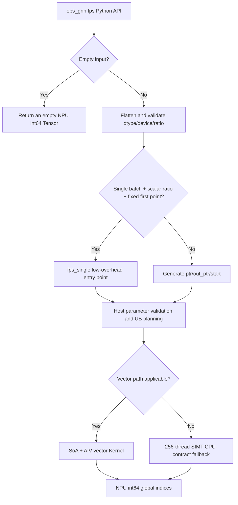

**Historical document note:** This is a complete translation of the inherited design document v1.2.0, as of 2026-09-23. Version dependencies and measured figures are retained as historical statements from the original and do not represent the current r3 run. The current source, runtime, and test collection must be established from separately bound evidence.

# Requirements Background (required)

## Requirements Source

This requirement comes from the CANN 2026/8 community task, "FPS Operator Development (950)." The task requires implementing an Ascend C Kernel and a PyTorch adaptation layer on Ascend 950 series NPUs with reference to `torch_cluster.fps`, and using the functionality, accuracy, and performance of the PyTorch-level `ops_gnn.fps()` as the acceptance criteria.

## Background

### FPS Operator Implementation Optimization

FPS (Farthest Point Sampling) is widely used in point cloud downsampling, 3D detection backbones, and geometric deep learning. Starting from an initial point in each batch, the algorithm repeatedly selects the point farthest from the set of selected points. It reduces the number of points while retaining the spatial coverage of the point set as much as possible.

Each FPS sampling iteration depends on the center point selected in the previous iteration, making this an algorithm with strong iterative dependencies. Within an iteration, however, distance updates and maximum selection over all candidate points can be parallelized. The implementation must balance iterative dependencies, vector throughput, UB capacity, and exact agreement of discrete indices.

### torch_cluster FPS Implementation Paths and Related API Paths

- Python interface: `torch_cluster/fps.py`
- CPU reference: `csrc/cpu/fps_cpu.cpp`
- CUDA reference: `csrc/cuda/fps_cuda.cu`
- Python interface of this implementation: `python/ops_gnn/fps.py`
- Host of this implementation: `csrc/npu/fps/op_host/`
- Kernel of this implementation: `csrc/npu/fps/op_kernel/arch35/`

### Original Capabilities and Scope of This Implementation

| Parameter | Meaning | Type | Supported Range | Constraints |
| --- | --- | --- | --- | --- |
| `src` | Point features | Tensor | float16, float32 | NPU; `[N, *]`, flattened internally to `[N, F]` |
| `batch` | Batch membership | Optional Tensor | int64 | `[N]`; points in the same batch are arranged contiguously |
| `ratio` | Sampling ratio | Optional float/Tensor | float16, float32 | Scalar or `[B]`; each value is in `(0, 1]` |
| `random_start` | Whether the first point is random | bool | `True`/`False` | Uses index 0 within the segment when `False` |
| `batch_size` | Number of batches | Optional int | Positive integer | `max(batch)+1` when omitted |
| `ptr` | CSR segment boundaries | Optional Tensor/List | int64 | Monotonically nondecreasing; first element 0, last element N |
| Return value | Global sampled indices | Tensor | int64 | NPU; length is the sum of the sampling counts of all segments |

# Requirements Analysis (required)

## Requirements Description

Add to `ops-gnn` a Python API with the same signature as `torch_cluster.fps`, four TorchScript overloads, an Ascend 950 arch35 Host/Kernel implementation, a CPU golden reference, self-test cases, performance tests, and documentation. Functional output must agree with the actual torch_cluster 1.6.3 CPU numerical behavior and first-index argmax semantics; all 42 official performance cases must achieve 0.45 times the benchmark performance.

## Requirements Breakdown

1. Align the public Python signature and the semantics of `ratio`, `batch`, `ptr`, empty input, and random starting points.
2. Support float16/float32 inputs and int64 metadata/outputs.
3. For each batch, output `ceil(float32(degree_b) * ratio_b)` global indices according to the torch_cluster 1.6.3 CPU path; a Python scalar ratio is first converted to a Tensor with `src.dtype`, while a Tensor ratio retains its input dtype.
4. Preserve the actual CPU numerical boundaries of `(x-x[idx]).pow_(2).sum(1)` and the `argmax` tie rule that selects the lowest absolute index.
5. Provide a low-overhead vector path for the official N/F/r performance matrix while also covering generalization shapes with large N and large F.
6. Provide independently reproducible current-contract tests across 61 self-built scenarios, full-repository regression tests, compatibility comparisons against the old attachment/raw upstream, and a 42-case performance gate; do not present these as the acceptance party's 66-case suite whose source code has not been obtained.

# Detailed Design (required)

## Operator Analysis

### Mathematical Formulas

Let the points in a batch be $X=\{x_i\}_{i=0}^{N_b-1}$, and let the set of selected indices be $S_t$. For each candidate point, maintain the minimum squared Euclidean distance to the selected set:

$$
d_i^{(t)}=\min_{j\in S_t}\lVert x_i-x_j\rVert_2^2.
$$

The $t+1$-th sampled point is:

$$
s_{t+1}=\operatorname*{argmax}_{i} d_i^{(t)}.
$$

The output count for each batch is:

$$
K_b=\left\lceil r_b N_b\right\rceil,
\qquad
K=\sum_b K_b.
$$

### Supported Data Types

- `src`: float16, float32.
- `batch`, `ptr`, `out_ptr`, `start`, and output: int64.
- Host internal reduction scratch space: float32 distances and int64 indices, with 256 entries of each type, for cross-lane merging in the SIMT fallback path.

### Supported Shapes

- The Python layer accepts `[N, *]` and flattens it using `reshape(N, -1).contiguous()`.
- Returns an empty output when `N=0`.
- Task functional cases cover `N=1..32000` and `F=3..768`.
- The task performance matrix covers `N=1024..16384`, `F=4/16/32/64`, and `ratio=0.25/0.5/1.0`.

## Operator Implementation

### Implementation Approach

##### Overall Execution Flow

##### Host-Side Design

**Python Adaptation Layer**

1. Provide the four `@torch.jit._overload` declarations required by the task specification; the TorchScript branch invokes the same Host/Kernel through the `torch.ops.ops_gnn.fps_batch` Dispatcher entry point, while retaining the low-overhead pybind fast path in eager mode.
2. Convert `ratio=None` to `0.5`; check that both scalar and Tensor values are in `(0, 1]`.
3. Give `ptr` priority; otherwise, count points by `batch` and generate CSR `ptr`; generate `[0, N]` when neither is provided.
4. Convert degree to float32, then multiply it by the ratio Tensor and apply ceil to generate `out_ptr`; the single-batch fast path follows the same ratio dtype and float32 multiplication rules.
5. For `random_start=True`, use the same process-global `libc rand() % degree` as torch_cluster 1.6.3 CPU; this state is not controlled by `torch.manual_seed`. Otherwise, the first point is 0.
6. Official performance scenarios satisfy "single batch, scalar ratio, fixed first point" and call `fps_single` directly, avoiding the construction/readback of small metadata Tensors.

**C++ Host Layer**

1. Validate that `src` is a two-dimensional contiguous NPU Tensor with dtype float16/float32.
2. The batched entry point validates the device, dtype, dimensionality, contiguity, first/last values, monotonicity, and ranges of `ptr/out_ptr/start`.
3. Launch the Kernel on the current PyTorch NPU stream without additional stream synchronization.
4. Query the platform UB size, reserve space for the center point, three point vectors, and reduction workspace, and compute `tile_points` aligned to 256 points, with a maximum of 16384.
5. Allocate `dist[N]` and output `out[K]`; the SIMT fallback path additionally uses 256 entries of `best_dist/best_index`.

##### Kernel-Side Design

The kernel includes two execution paths.

**AIV Vector Performance Path**

- Applicability: `N <= 16384`, and `F <= 64` for float32; float16 can use this path throughout this N range.
- The Host transposes the input from AoS `[N,F]` to SoA `[F,N]`, making points for the same feature contiguous for vector transfers.
- For fp16, subtraction and squaring are first performed in half; the square of each dimension is converted to fp32 for accumulation, and the distance is rounded back to fp16 after all features are processed; the nearest state remains fp16.
- In the current validation environment, PyTorch 2.9.1 reports CPU capability AVX512, but measurements of contiguous fp32 sum show a W=8, ILP=4 addition tree. For F=5..64, merging follows these four partial rows, the scalar tail, and the horizontal order of lane0..7; F<=4 retains an equivalent low-overhead path.
- `nearest = min(nearest, current_distance)` stays in UB throughout; each iteration uses `ReduceMax` to obtain the next center point.
- Aligning the tile point count to 256 serves only the transfer and reduction layout and does not alter the public tie semantics.
- If the maximum distance is tied, the lowest absolute index is selected both within and across tiles, matching the first-index behavior of CPU `argmax`.

**SIMT CPU-Contract Fallback Path**

- float32: `F > 64` or `N > 16384`.
- float16: `N > 16384`.
- Each of the 256 SIMT threads processes points at `lane + 256*k`; within a thread, an update occurs only for a strictly greater distance, and equal distances retain the lower absolute index. Results are then merged across lanes using `(distance desc, absolute index asc)`.
- fp16 subtraction and squaring are each rounded back to half; squares are converted to fp32 and accumulated sequentially, and the final distance is rounded back to half.
- fp32 uses the complete four-level W=8/ILP=4 cascade measured for the current PyTorch build and separates multiplication from addition to avoid FMA contraction. This addition tree is tied to the current acceptance environment; no claim of universal bitwise agreement across PyTorch versions/ISAs is made.
- The initial nearest value is positive infinity, avoiding the truncation of valid large distances by a fixed value of 50000.

**Batch Scheduling**

The output intervals of different batches may share a 32-byte GM transaction. To avoid races between unaligned int64 scalar writes, one AIV block currently processes the batches sequentially. All official performance matrix cases use a single batch and are unaffected by this strategy.

## Data Validation

- `src`: defined, NPU, contiguous, float16/float32, with the point count not exceeding the int32 limit.
- `batch`: one-dimensional, length N, int64; batch points are arranged contiguously in CSR order.
- `ratio`: scalar or one value per batch, nonempty, with all values in `(0, 1]`.
- `ptr`: one-dimensional int64, at least two elements, monotonically nondecreasing, first element 0, last element N.
- `out_ptr`: the same length as `ptr`, first element 0, monotonically nondecreasing, with the output count of each segment not exceeding its point count.
- `start`: length equal to the number of batches; for nonempty segments, satisfies `0 <= start < degree`.

## Supported Hardware

| Supported Chip Version | Selected |
| --- | :---: |
| Ascend 950PR / Ascend 950DT (dav-3510 / arch35) | √ |
| Atlas A2/A3 (dav-2201 / arch22) | × |

## Operator Constraints and Limitations

- Currently, only the NPU path is implemented; no CPU fallback is provided.
- Points in the same batch described by `batch` must be arranged contiguously, consistent with CSR `ptr` semantics.
- Input dtype supports only float16 and float32; indices and output support only int64.
- `ratio` does not support 0, negative values, or values greater than 1.
- FPS has dependencies between successive iterations; as the sampling ratio increases, iteration count and runtime increase approximately linearly.

# Maintainability and Testability Analysis

## Accuracy/Performance Criteria

| Acceptance Criterion | Description | Source |
| --- | --- | --- |
| Accuracy criterion | With a fixed starting point, the int64 output indices for float16/float32 must agree exactly, element by element, with the task CPU golden reference | FPS community task specification |
| Randomness criterion | Set the same libc srand separately before the CPU/NPU calls; with single-threaded CPU execution, indices agree for `random_start=True` | torch_cluster 1.6.3 CPU + formal CPU acceptance criteria |
| Performance criterion | 21 shapes × 2 dtypes, totaling 42 cases; each must satisfy `official_reference_ms / measured_ms >= 0.45` | FPS community task specification |

## Test Case Planning

| Category | Case | Input/Parameters | Verdict |
| --- | --- | --- | --- |
| Basic functionality | Common shapes | N=128/256/512/1024/2048, F=3/32/64 | Indices agree element by element |
| Generalization shapes | Large N/large F | `(4096,128)`, `(8192,256)`, `(512,768)`, `(32000,3)`, `(16000,128)` | Indices agree element by element |
| dtype | fp16/fp32 | All major shapes | Indices agree element by element |
| batch | Single/multiple/one batch per point | 4×64, 5×1 | shape, dtype, and global indices agree |
| CSR | List/Tensor, nonuniform segments | `[0,32,96,128]`, `[0,40,100,120]`, etc. | Indices agree element by element |
| ratio | Scalar/per-batch/boundary | 0.01, 0.25, 0.5, 0.9, 1.0 | ceil length and indices agree |
| Starting point | Fixed/random | `random_start=False/True` | Exact agreement/reproducible with fixed libc srand |
| Empty input | `[0,3]` | ratio=0.5 | Empty NPU int64 output |
| Ties | Multiple absolute indices at equal distances | fp16/fp32 | Agrees with CPU argmax; selects the lowest absolute index |
| TorchScript | float/Tensor ratio × Tensor/List ptr | Four overloads | Compiles successfully, with NPU results agreeing with eager |
| Performance | Official matrix | 21 shapes × 2 dtypes, 20 warmup + 100 iter | 42/42 achieve 0.45 times the benchmark performance |

## Maintainability Design

- Separate the Python public semantics, Host validation, and Kernel computation into layers; internal optimizations do not alter the public interface.
- The conditions for choosing the vector path or the SIMT CPU-contract fallback path are centralized in the Kernel launcher, facilitating future arch35 specialization.
- Query the UB size from the platform instead of hardcoding the device's total UB capacity; the tie contract is independent of the tile/lane layout.
- Test scripts provide human-readable logs, JSON, and CSV, and return a nonzero status when the performance gate fails.

## Compatibility Analysis

FPS is a new operator and does not modify the function signatures or behavior of existing operators. The new exports are enabled only in the dav-3510 build branch; the existing dav-2201 `spmm_max` build path does not include the FPS Host/Kernel. The old bundled oracle is still written using per-dimension half, mod-256 ties, float32 count, and torch.manual_seed; the measured result on frozen v7 was 44/61, while the raw torch_cluster count on the same inputs was 58/61. Both are listed separately as compatibility differences; the golden reference is not modified to conceal them.

## Risks and Fallback Plans

- The current fp32 addition tree is tied to PyTorch 2.9.1 and the measured CPU dispatch; evidence must be collected again if the acceptance environment changes, and bitwise agreement must not be generalized to all AVX512 machines.
- Disclosed differences exist between the old attachment and the current formal CPU contract; the default tests use the current contract, while the old attachment/raw upstream are still run explicitly and their failures retained.
- If the performance matrix is expanded to multiple batches in the future, multicore scheduling grouped by aligned output intervals can be added; it will not be enabled until the absence of GM write conflicts has been demonstrated.

# Appendix: Revision History

| Date | Version | Modification Description |
| --- | --- | --- |
| 2026-09-23 | v1.2.0 | Corrected ratio dtype and float32 sampling count according to formal acceptance Issue #2; retained the historical criteria and failure evidence of Issue #1 |
| 2026-09-21 | v1.1.0 | Aligned with the actual CPU numerical behavior, first-index ties, double ceil, and libc rand in the formal rejection report; added compatibility differences and full gate boundaries |
| 2026-09-17 | v1.0.1 | Added Torch Dispatcher registration, compilation of the four TorchScript overloads, and NPU execution validation |
| 2026-09-17 | v1.0.0 | Completed the FPS Python/Host/arch35 Kernel design, exact semantics, tests, and performance gates |
